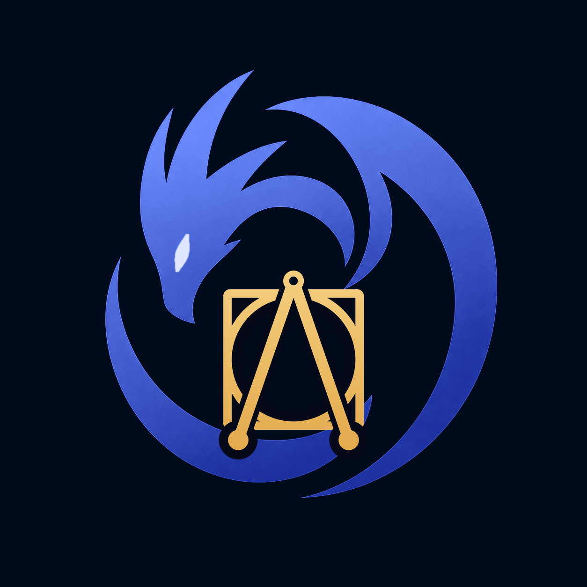
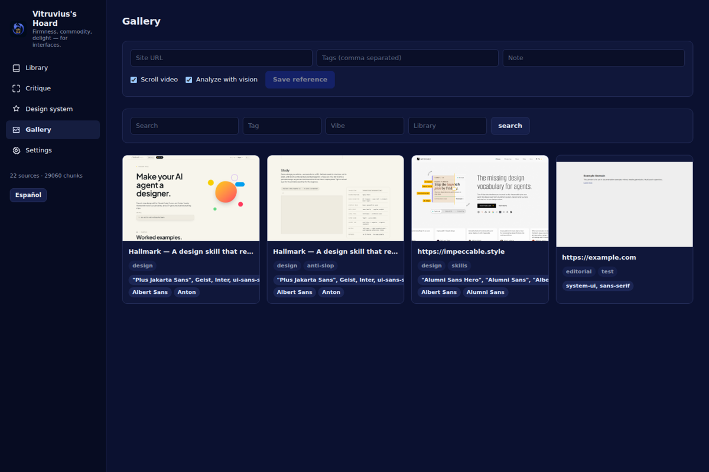
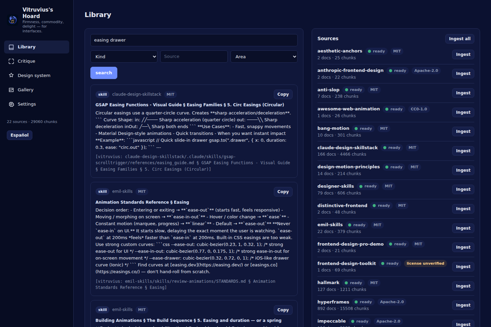
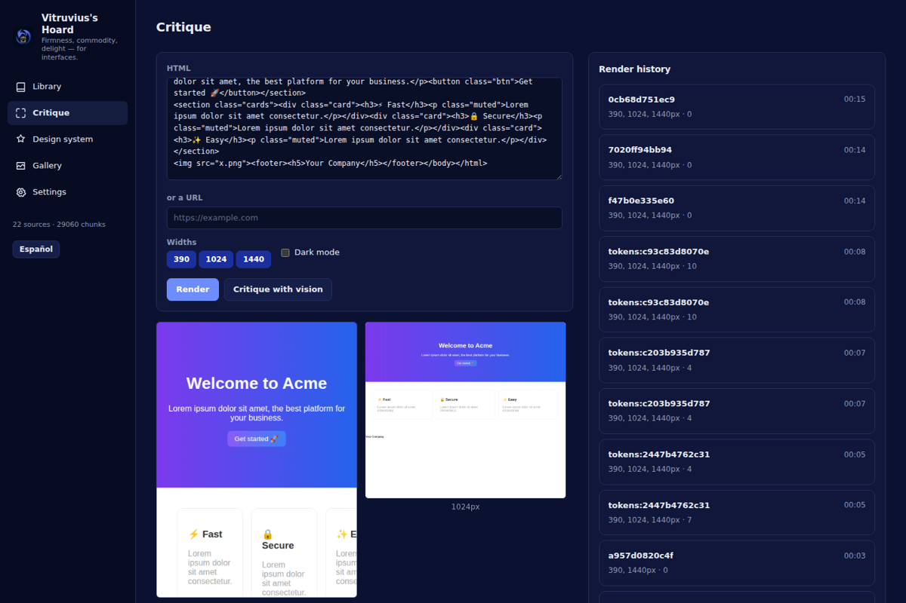
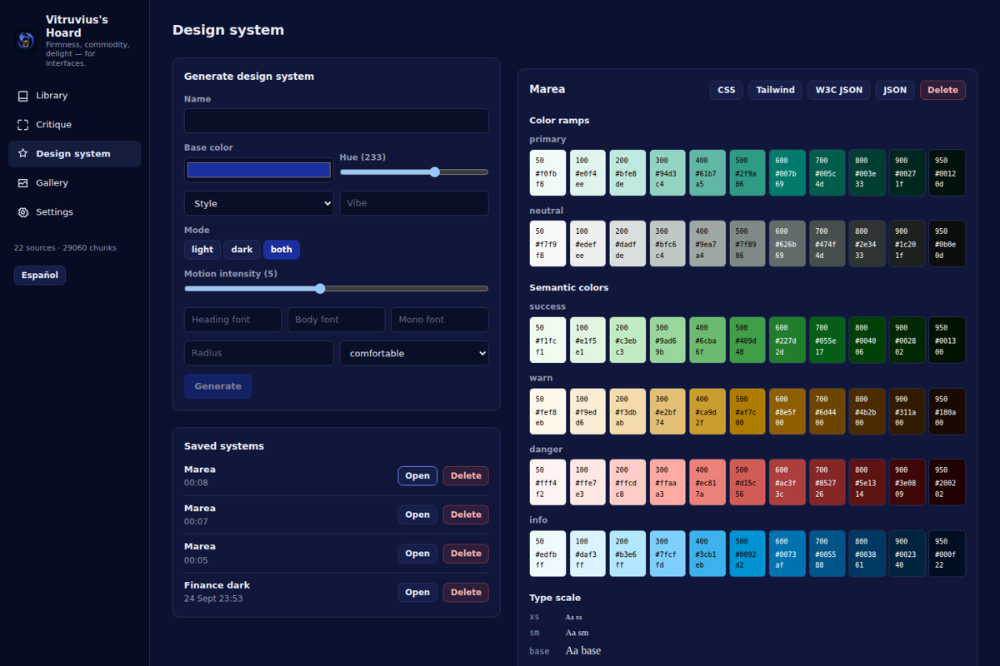

# Vitruvius's Hoard

Banco de trabajo de software local: diseño de interfaces, documentación de API por versión exacta e ingeniería inversa en una sola app. [English](README.md)



## Qué es

Vitruvius's Hoard es el estudio de diseño y análisis de software de la familia Hoard. Tiene tres módulos nativos independientes: **Diseño** (biblioteca de diseño de interfaces, renderizado, crítica, tokens, movimiento, diagramas y proyectos de aplicación), **APIs** (documentación y comprobación de librerías Python por versión exacta) e **Ingeniería inversa** (análisis estático y dinámico de binarios, paquetes y capturas web). Todos los módulos y todo el trabajo automático están desactivados al arrancar; activa solo lo que necesites.

Un espacio de trabajo raíz los une: un proyecto de diseño/código con una revisión exacta puede vincularse a entornos de API y a un proyecto de ingeniería inversa, y los resultados siguen indicando la revisión para la que se produjeron aunque el código se edite después.

El trabajo con modelos de lenguaje usa solo el modelo global elegido a través de Faustus. Las claves de proveedor se quedan en Faustus y no hay modelo local de reserva.

## Qué hace

### Biblioteca y reglas de diseño
- Biblioteca consultable de criterios de diseño, estilos, paletas y parejas tipográficas, y una galería de referencias con colecciones, patrones HTML originales y galerías de diseño curadas que se pueden capturar como referencias.
- Registro de reglas de lint (motores estático, de navegador y visual) con severidades, paquetes y textos en español; `design_lint` puede ejecutar solo el motor estático tras cada edición.
- Crítica en tres niveles: Suelo (nunca se exime), Reflejo (se puede eximir con una justificación razonada) y Acabado (consejo). La puerta pasa solo sin hallazgos de Suelo ni de Reflejo abiertos; una revisión en contexto limpio da una segunda mirada nueva.
- Auditoría de «slop»: renderiza una página en ocho anchos y puntúa de 0 a 100 las señales de aspecto genérico de IA, con plan de arreglo y un briefing de dirección de diseño.
- Reparto de temas con memoria (la misma semilla da el mismo tema, los recientes se bloquean), 120 preajustes de diseño con tokens completos claro/oscuro y elementos de registro shadcn, e importación de un marco de Figma con un token de acceso personal.
- Tokens de diseño con paletas OKLCH, vista previa y exportación a CSS y Tailwind.
- Comprobación de elementos conservados y ensayo de página: guarda los enlaces, campos y manejadores de una página y verifica que un rediseño los mantiene.
- Una biblioteca de recetas de escaparate en `/showcase/` con páginas de referencia funcionales, prompts de reproducción y skills para agentes.

### Renderizado y comparación
- Renderiza HTML o una URL en Chromium a capturas (varios anchos) y vídeo de desplazamiento; compara dos renders.
- Paridad visual: comparación en navegador congelado de un candidato con una referencia, pantalla a pantalla, con máscara de ruido.
- Rehacer: reconstruye una página pública desde su URL o una captura hasta alcanzar paridad visual, como copia o como reconstrucción, con código descargable e informe.
- Un banco de reconstrucción versionado sobre páginas de referencia fijadas, con puntuaciones por versión, runtime y hash de código. Véase [docs/BENCHMARKS.md](docs/BENCHMARKS.md).
- Diseño por alternativas comparables: criterios congelados, alternativas medidas, frontera de Pareto, ranking reponderable y decisión registrada.

### Movimiento, diagramas y marcas
- Composiciones de movimiento (línea de tiempo, plantillas) renderizadas a MP4 o HTML, con eventos de sonido mezclados a -14 LUFS.
- Editor de diagramas con plantillas, conectores, grupos, deshacer/rehacer y revisiones; diagramas isométricos, perfiles de marca, biblioteca reutilizable de estilos de forma, importación de subconjuntos de Mermaid, Excalidraw y draw.io, y exportación a JSON, SVG, PNG, PDF o un lector HTML interactivo. Véase [docs/DIAGRAM_EDITOR.md](docs/DIAGRAM_EDITOR.md).
- Auditoría de logotipos y hoja de pruebas: comportamiento en un color, contraste, legibilidad en tamaño pequeño y más, puntuado sobre 100.
- Auditoría SEO y GEO de sitios con indexabilidad, cabeceras de seguridad, web vitals, acceso de rastreadores de IA y plan de acción por fases. Véase [docs/SITE-AUDIT.md](docs/SITE-AUDIT.md).

### Proyectos de aplicación e instrumentos
- Proyectos de código de aplicación con plantillas, acciones tipadas, vistas previas locales propias, comprobador funcional de páginas y exportación autónoma. Véase [docs/APP_PROJECTS.md](docs/APP_PROJECTS.md).
- Fábrica de instrumentos: una especificación tipada de entradas, fórmulas y salidas se convierte en un proyecto de aplicación con pruebas generadas y una exportación autónoma solo con la biblioteca estándar, más un explicador. Véase [docs/INSTRUMENTS.md](docs/INSTRUMENTS.md).
- Comprobador de protocolos: explora todos los entrelazados de un protocolo pequeño y acotado, comprueba invariantes e interbloqueos y devuelve el contraejemplo más corto con un archivo pytest que lo reproduce.

### APIs (Babel)
- Indexa paquetes Python por versión exacta, responde consultas y comprueba código contra el entorno elegido, con docsets, idiomas y Ask the docs.
- Ensayo de actualización de dependencias: indexa las versiones actual y destino en una carpeta aislada, compara la superficie de la API y clasifica cada uso en un proyecto como roto, en riesgo o correcto.

### Ingeniería inversa (Theseus)
- Proyectos, artefactos, hallazgos, escenarios, comparaciones, sesiones nativas, grabaciones y evidencia portátil que sigue siendo legible tras importarla, sin los archivos originales.
- Análisis de binarios: consultas de solo lectura y ejecución explícita de comandos, inspección con herramientas GNU, estructura ELF, símbolos y contexto nativo, paquetes y recursos de Android, miembros .NET, código Electron, firmware, snapshots de Flutter/Dart, WebAssembly, capturas de paquetes y sesiones con editores en vivo.
- Capturas web: bytes de scripts y mapas de fuentes, capturas de procesos con servicios declarados y comprobaciones de reconstrucción por escenarios.
- Taller de equivalencia: suites de comandos de referencia/candidato comparadas en sandboxes nuevos e idénticos, pruebas de propiedades con reducción, banco de reglas con comprobaciones ejecutables, secuencias con estado contra un servicio HTTP real y taller causal de rendimiento.
- El alcance implementado y las lagunas conocidas están en [docs/THESEUS-COVERAGE.json](docs/THESEUS-COVERAGE.json) y en la [sincronización de código](docs/THESEUS-SYNC.md); el módulo cubre lo que ese inventario declara.

## Cómo ejecutarlo

Requiere Python y Node 22.19+ (para el núcleo de análisis).

```bash
pip install -e .            # extras opcionales: [render], [vectors], [runtime]
npm ci && npm run build     # también en babel_client/ y en software_native/engine/
python -m vitruvius_hoard   # http://127.0.0.1:5191
```

- `VITRUVIUS_PROFILE_DIR` contiene `design/`, `babel/`, `theseus/` y `software-links.db`; por defecto, una instalación usa `%LOCALAPPDATA%/VitruviusHoard/data` (o `~/.local/share/VitruviusHoard/data`).
- `VITRUVIUS_TOKEN_FILE` guarda el token del propietario. `PORT_STRICT=1` fija el puerto.
- Los extras opcionales `[render]`, `[vectors]` y `[runtime]` aportan renderizado con Chromium, embeddings locales e integración con Frida. Véase la [guía del espacio de trabajo](docs/SOFTWARE-WORKSPACE.es.md).

## Conexión con Faustus y el Hoard Hub

- `faustus-plugin.json` es el manifiesto del plugin (URL por defecto `http://127.0.0.1:5191`, salud en `/api/health`).
- `python -m mcp_server` expone los esquemas de herramientas en frío (diseño, documentación de API, ingeniería inversa y controles comunes) sin arrancar la app ni abrir ningún almacén. `VITRUVIUS_URL` apunta a la app en marcha. API, MCP e interfaz comparten los mismos manejadores. Véanse [docs/SOFTWARE-API.md](docs/SOFTWARE-API.md) y [docs/NATIVE-CONNECTIONS.md](docs/NATIVE-CONNECTIONS.md).
- El panel común de Faustus está disponible dentro de la app.
- La app lleva skills de la biblioteca de la familia para los agentes conectados (bucle de diseño, interfaz sin «slop», accesibilidad, autoría de diagramas, consulta de documentación, análisis de impacto de código, flujo de ingeniería inversa y otras), que se leen con `skills_list` y `skill_read` y se eligen en la página de skills.

<details>
<summary>Catálogo MCP de diseño</summary>

`design_search`, `design_brief`, `design_rules`, `styles_search`, `palettes_search`, `fonts_search`, `render_preview`, `design_lint`, `design_critique`, `page_assay`, `render_compare`, `tokens_generate`, `tokens_get`, `tokens_list`, `tokens_preview`, `tokens_delete`, `app_templates`, `app_project_create`, `app_project_list`, `app_project_get`, `app_project_update`, `app_project_preview`, `app_project_export`, `app_project_render`, `app_project_call`, `reference_collections`, `reference_import_collection`, `design_patterns`, `design_pattern`, `reference_add`, `reference_search`, `reference_get`, `reference_delete`, `design_galleries`, `design_gallery_ingest`, `sources_list`, `source_add`, `source_ingest`, `source_status`, `vitruvius_status`, `motion_templates`, `motion_save`, `motion_list`, `motion_get`, `motion_render`, `motion_sound_plan`, `motion_sound_render`, `site_audit`, `site_audit_reports`, `mark_audit`, `mark_test_sheet`, `mark_reports`, `diagram_style_list`, `diagram_style_get`, `diagram_style_save`, `diagram_style_remove`, `diagram_style_apply`, `diagram_document_list`, `diagram_document_get`, `diagram_document_save`, `diagram_document_edit`, `diagram_document_undo`, `diagram_document_history`, `diagram_document_compare`, `diagram_document_import`, `diagram_types`, `diagram_render`, `diagram_get`, `diagram_list`, `diagram_delete`, `diagram_brand_onboard`, `diagram_brands`, `diagram_brand_delete`, `page_check`, `design_rules_list`, `theme_list`, `theme_deal`, `theme_check`, `theme_memory`, `page_kept`, `design_slop_audit`, `design_direction_brief`, `design_preset_list`, `design_pick_themes`, `design_preset_apply`, `design_figma_import`, `protocol_check`, `design_alternatives_create`, `design_alternatives_list`, `design_alternatives_get`, `design_alternatives_add`, `design_alternatives_evaluate`, `design_alternatives_criteria`, `design_alternatives_analyze`, `design_alternatives_decide`, `instrument_create`, `instrument_list`, `instrument_get`, `instrument_update`, `instrument_compute`, `instrument_explain`, `instrument_check`, `instrument_export`, `visual_parity`, `visual_parity_get`, `visual_parity_list`, `visual_parity_delete`, `remake_start`, `remake_get`, `remake_list`, `remake_code`, `remake_continue`, `remake_stop`, `remake_delete`, `benchmark_catalog`, `benchmark_start`, `benchmark_get`, `benchmark_list`, `benchmark_compare`, `benchmark_stop`, `benchmark_resume`

</details>

## Pantallas

<details>
<summary>Capturas</summary>

 
 

</details>

## Estructura del proyecto

| Ruta | Contenido |
| --- | --- |
| `vitruvius_hoard/` | Paquete Python: API, herramientas de diseño, renderizado, crítica, diagramas, bancos de pruebas |
| `client/` | Interfaz React/Vite |
| `babel_client/`, `babels_hoard/` | Módulo de documentación de API |
| `theseus/`, `software_native/` | Módulo de ingeniería inversa y motor de análisis en Node |
| `mcp_server.py` | Puente MCP por stdio |
| `faustus-plugin.json` | Manifiesto del plugin de Faustus |
| `docs/` | Documentación de referencia |
| `provenance/` | Inventario de orígenes y licencias |
| `tests/`, `babel_tests/`, `theseus_tests/` | Pruebas |

## Desarrollo

```bash
python -m pytest -q
```

Licencia: véanse `LICENSE`, `NOTICE` y `THIRD_PARTY_NOTICES.md`.
