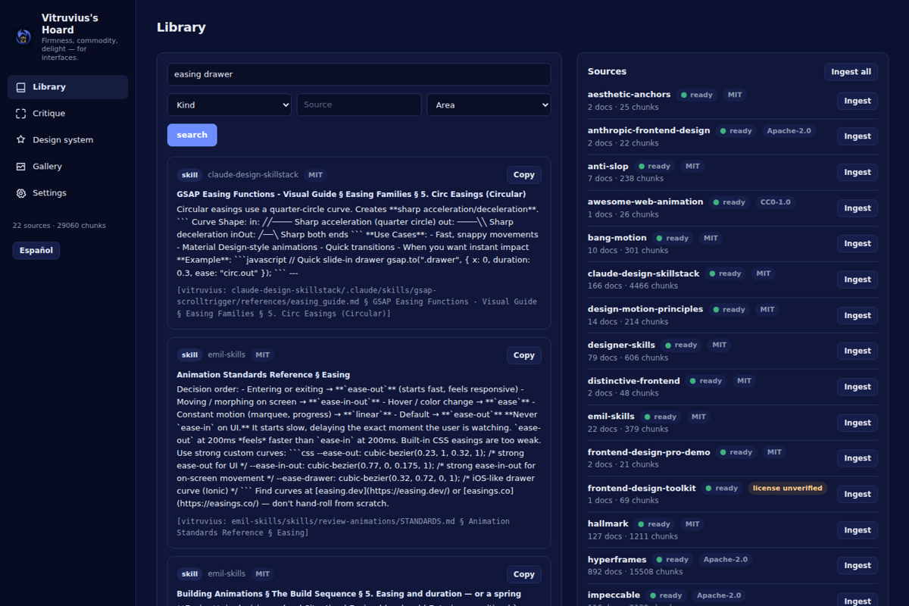
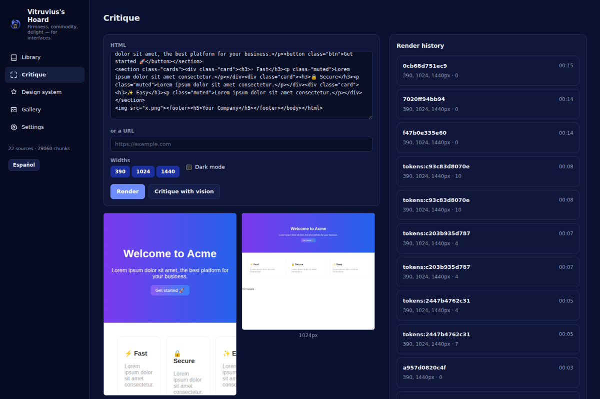
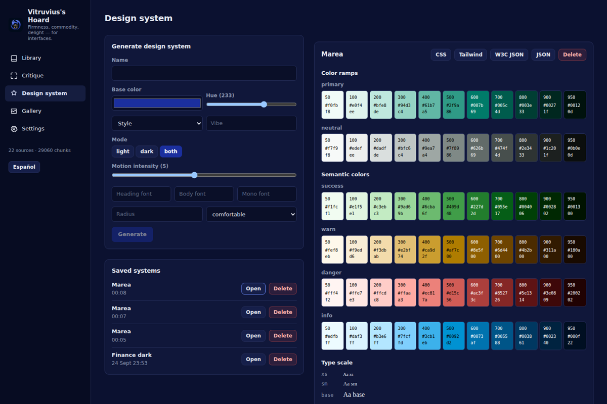
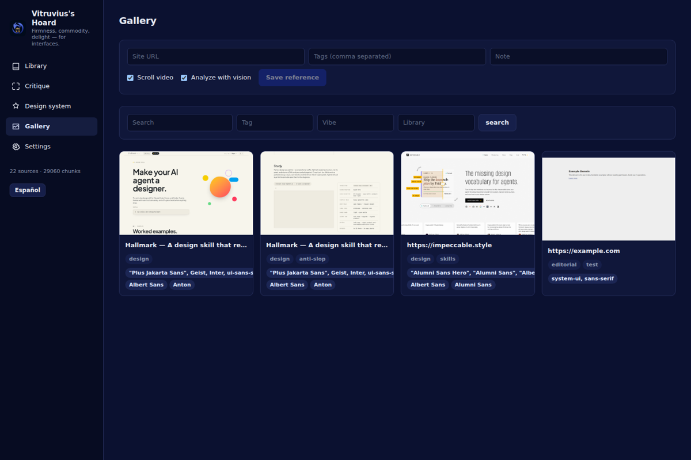

# Vitruvius's Hoard

Un taller de diseño de interfaces local, para el asistente (el entorno Faustus) y para la persona que lo usa: el
"sentido del diseño" que le falta a un modelo de código en bruto. Cuatro núcleos, una sola app:

- una **biblioteca de criterio** ingerida desde repositorios abiertos de skills de diseño (reglas, estilos,
  paletas, combinaciones tipográficas, recetas de motion), buscable con citas;
- un **ciclo de render → captura → crítica** sobre Chromium real: renderiza HTML o una URL, la captura a varios
  anchos, ejecuta 29 comprobaciones deterministas de lint de diseño y, opcionalmente, obtiene una crítica de un
  modelo de visión;
- un **generador de sistemas de diseño**: rampas de color OKLCH en Python puro, una escala tipográfica fluida,
  tokens de espaciado/radio/sombra/motion, exportados como variables CSS, un tema de Tailwind v4, JSON de design
  tokens W3C y un JSON plano, más una página de playground autocontenida y en vivo;
- una **galería de referencias**: captura una web con sus capturas de escritorio y móvil, un vídeo de scroll, sus
  fuentes, paleta y librerías de animación, y búscalas después por etiqueta, vibe o librería.

Todo lo anterior se expone tanto como una pequeña API REST (para su propia interfaz) como 38 herramientas MCP
(para el asistente), construidas desde el *mismo* código, para que nunca puedan discrepar.

## Por qué

Los modelos de código son fluidos escribiendo código pero por defecto caen en el mismo puñado de páginas
genéricas: Inter sobre blanco, un botón con degradado morado a azul, una sección hero seguida de tres tarjetas.
Vitruvius's Hoard le da a un asistente un sitio donde consultar criterio de diseño real (con cita, no con una
suposición), una forma de *ver* de verdad lo que construyó (render + captura, no solo markup) y una forma
determinista de señalar los patrones genéricos delatores antes de que una persona tenga que decir "esto parece
hecho por una IA".

## Funcionalidades

- **Biblioteca**: búsqueda de texto completo (SQLite FTS5, ranking `bm25`) sobre los repositorios de skills
  ingeridos, con un rerank vectorial opcional una vez existen embeddings. Cada resultado lleva una cita
  `[vitruvius: fuente/ruta § encabezado]`.
- **Búsqueda por significado, en cualquier idioma**: un modelo de frases multilingüe calcula un vector por fragmento,
  indexado por el hash del texto para que reingerir solo calcule lo que cambió. Los vectores vienen de Borges's Hoard
  a través del hub de Hoard Link cuando está en marcha (un único modelo para toda la familia) o, si no, de un modelo
  en el propio proceso (ONNX con fastembed, CPU, ~120 MB); el índice guarda los vectores por nombre de modelo y nunca
  mezcla dos; `design_search` fusiona palabras y significado por rango
  recíproco, así que «¿cómo hago que los botones parezcan pulsables?» encuentra criterio escrito en inglés. Cada
  resultado dice cómo se encontró (`bm25`, `dense`, `both`).
- **Briefs de diseño**: una composición determinista de 2-3 estilos que encajan, una paleta, una combinación
  tipográfica, reglas por área y una checklist previa a la entrega — todo citado, con un párrafo opcional de
  dirección de arte de 150 palabras generado por un modelo local.
- **Render y captura**: un único worker de Chromium en segundo plano (Playwright), capturas a cualquier ancho, un
  vídeo opcional de scroll de 6 segundos (convertido a MP4 con ffmpeg si está en el `PATH`), y una sonda en la
  propia página (fuentes, colores calculados, encabezados, pares de contraste, tamaño de zonas táctiles, número
  de animaciones, librerías externas).
- **Lint de diseño**: 29 comprobaciones deterministas (tipografía, contraste, layout, motion, accesibilidad,
  contenido, rendimiento, y varios detectores de "paleta genérica de IA") con id estable, severidad, evidencia y
  una corrección concreta por hallazgo.
- **Crítica**: los hallazgos del lint combinados con una rúbrica opcional de modelo de visión (jerarquía,
  tipografía, color, espaciado, motion, distintividad, accesibilidad, copy), puntuada de 0 a 10.
- **Design tokens**: rampas OKLCH (50-950), colores semánticos, superficies claro/oscuro, escala tipográfica
  fluida, espaciado, radio, sombras y tokens de motion (duraciones, easings, un knob de intensidad de motion),
  exportados de cuatro formas.
- **Galería de referencias**: captura cualquier URL o HTML en bruto, extrae su paleta (cuantización con Pillow),
  las librerías de animación detectadas y sus características de motion, y búscalas después.
- **Diagramas**: ocho tipos (flujo, arquitectura, estados, entidad-relación, carriles, secuencia, cronología,
  gantt), elegidos primero por patrón para que un modelo pequeño lea una sola ficha. El modelo da solo la
  estructura; el layout es una rejilla por capas con enrutado ortogonal (las aristas largas van por los huecos y
  cada grupo tiene su banda), dibujada en SVG claro y oscuro con los roles de la marca (papel, tinta, apagado,
  acento, superficie, borde, series). Los perfiles de marca salen de una web renderizada en el navegador, de una
  carpeta de CSS o tokens, de un design system o de colores sueltos. Las comprobaciones miran contraste (4,5:1
  texto, 3:1 líneas), solapes, aristas que atraviesan cajas, etiquetas que no caben, grupos y lienzo; la
  comprobación en navegador guarda una captura. Importa Mermaid (flowchart, sequence, state, er, timeline, gantt),
  Excalidraw y draw.io (normal o comprimido) y los redibuja con la marca. Límites: ocho tipos, hasta 80 nodos; el
  ancho de las etiquetas se estima, no se mide con la fuente.
- **MCP + REST**: 38 herramientas detrás de un único puente protegido por token, más las rutas REST idénticas que
  usa la interfaz incluida (ver `docs/API.md`).

## Instalación

### Requisitos

- Python 3.11+ (objetivo en Windows: 3.13)
- Node.js 22+ (solo para compilar el cliente)
- `git` en el `PATH` (para ingerir fuentes)
- `ffmpeg` en el `PATH` (opcional, para vídeos MP4 — si no está, se conserva el WebM)
- Un Chromium accesible por Playwright: ejecuta `python -m playwright install chromium` una vez, o ten Edge/Chrome
  instalado (el worker de render recurre a `channel="msedge"` / `channel="chrome"`)

### Linux / macOS

```bash
python3 -m venv venv
source venv/bin/activate
pip install -r requirements.txt
python -m playwright install chromium
npm install
npm run build
python -m vitruvius_hoard
```

### Windows

```powershell
py -3.13 -m venv venv
venv\Scripts\activate
pip install -r requirements.txt
python -m playwright install chromium
npm install
npm run build
python -m vitruvius_hoard
```

La app escribe sus datos en `data/` junto a este repositorio (se puede cambiar con `VITRUVIUS_DATA_DIR`), elige
un puerto libre a partir del `5191` (cámbialo con `VITRUVIUS_PORT`, o fija `PORT_STRICT=1` para exigir ese puerto
exacto), y escribe `data/mcp-token` y `data/url` al arrancar. Un segundo `python -m vitruvius_hoard` avisa de la
instancia que ya corre y sale.

Otras variables: `VITRUVIUS_ALLOWED_HOSTS` (nombres de host extra a los que responde la guarda, `host` o `host:puerto`),
`VITRUVIUS_ALLOW_LOCAL_URLS=1` (deja que `render_preview`, `reference_add`, `design_lint` y `page_assay` abran páginas
de localhost o de la red privada, por ejemplo un servidor de desarrollo; las direcciones de metadatos de la nube
siguen bloqueadas), `VITRUVIUS_EMBED=auto|family|local|fake|none` (de dónde salen los vectores semánticos; `family`
es solo Borges, `local` solo el modelo del propio proceso) y `VITRUVIUS_MODELS_DIR` (dónde se guarda ese modelo, por
defecto `data/models`).

### Piezas comunes

La parte de servidor es la biblioteca compartida Hoard Link, copiada en `vitruvius_hoard/hoard_link/` (no se edita
aquí): guarda de host y origen, manejo de errores, `/api/health`, archivos PWA y SPA, archivos de puerto y de token (el
token tiene al menos 32 caracteres), lectura de configuración, el envoltorio de SQLite, el enrutador de agente y el
puente MCP. También son compartidos el descubrimiento del navegador (Chrome o Edge del sistema, Chromium de
Playwright), la política de seguridad de URLs (solo se abren páginas web públicas), la descarga de páginas para
`page_assay` (por el servicio web de la familia cuando corre), los metadatos de página, el troceado de markdown, la
construcción de consultas, las citas, la fusión de rankings, el lanzador de procesos (git, ffmpeg, assay) y el cliente
de embeddings. `PORT` ya no se lee como alternativa del puerto; usa `VITRUVIUS_PORT`.

## Configuración MCP

Apunta tu asistente compatible con MCP a `mcp_server.py` con el mismo intérprete de Python de arriba. El
`faustus-plugin.json` incluido es el manifiesto que lee el entorno Faustus para conectarlo automáticamente (id
`vitruvius`, comprobación de salud en `/api/health`, puente MCP por stdio). Para una entrada manual en
`mcp.json`:

```json
{
  "mcpServers": {
    "vitruvius-hoard": {
      "command": "/ruta/al/venv/bin/python",
      "args": ["/ruta/a/vitruvius/mcp_server.py"],
      "env": { "VITRUVIUS_URL": "http://127.0.0.1:5191" }
    }
  }
}
```

El puente nunca abre la base de datos por sí mismo: reenvía cada llamada a `POST /api/agent/call` en la app en
ejecución (arrancándola automáticamente si no lo está) usando el token del portador en `data/mcp-token`.

## Herramientas

| Herramienta | Solo lectura | Qué hace |
| --- | --- | --- |
| `design_search` | sí | Busca en la biblioteca de diseño: reglas, skills, estilos, recetas de motion con citas. |
| `design_brief` | sí | Brief de diseño para una página/app: estilo, paleta, tipografías, reglas, motion, anti-patrones. |
| `design_rules` | sí | Lista reglas de diseño por área (tipografía, color, layout, motion, a11y, formularios). |
| `styles_search` | sí | Encuentra estilos de UI (glass, brutalist, swiss, aurora…) con tokens y cuándo usarlos. |
| `palettes_search` | sí | Encuentra paletas de color catalogadas por nombre o tipo de producto. |
| `fonts_search` | sí | Encuentra combinaciones tipográficas catalogadas por mood o consulta. |
| `render_preview` | no | Renderiza HTML o una URL en Chromium, captura a varios anchos, ejecuta el lint. |
| `design_lint` | sí | Comprobaciones deterministas de diseño sobre HTML/URL (tipografía, contraste, motion, a11y, patrones genéricos de IA). |
| `design_critique` | no | Critica una página renderizada: puntuación 0-10, hallazgos con arreglos, usando lint + modelo de visión local. |
| `page_assay` | sí | Comprobación funcional de una página generada en un navegador real: ¿funciona cada control? Ejecuta [assay](https://github.com/awss1i/assay) (`pip install assay-ui`), sin tests escritos ni modelo. |
| `render_compare` | sí | Diferencia de píxeles entre dos renders a un ancho dado: porcentaje cambiado + imagen de diferencia. |
| `tokens_generate` | no | Genera un sistema de diseño: paletas OKLCH, escala tipográfica, espaciado, tokens de motion. |
| `tokens_get` | sí | Obtiene un sistema de diseño generado en formato json, css, tailwind o w3c; el json incluye también `roles`. |
| `tokens_list` | sí | Lista los sistemas de diseño generados con sus `roles`; con `compact=true` solo id, nombre y roles. |
| `tokens_preview` | no | Renderiza el playground en vivo del sistema de diseño y lo audita. |
| `tokens_delete` | no (destructiva) | Elimina un sistema de diseño generado (solo cuando el usuario lo pide). |
| `reference_add` | no | Captura una web en la galería de referencias: capturas, vídeo, tipografías, paleta. |
| `reference_search` | sí | Busca en la galería de referencias por texto, etiquetas, vibe o librería. |
| `reference_get` | sí | Obtiene el detalle completo de una referencia (archivos, paleta, tipografías, motion, análisis). |
| `reference_delete` | no (destructiva) | Elimina una referencia de la galería (solo cuando el usuario lo pide). |
| `sources_list` | sí | Lista cada fuente de criterio de diseño ingerida y su estado. |
| `source_add` | no | Añade una nueva fuente a ingerir: un repo git, una carpeta local o una URL de una sola página. |
| `source_ingest` | no | Ingiere (o reingiere) una fuente o todas; se ejecuta en segundo plano. |
| `source_status` | sí | Estado de la ingesta de una fuente (idle, cloning, ingesting, ready, error). |
| `vitruvius_status` | sí | Salud: navegador, ffmpeg, git, contadores de la biblioteca, resolución de modelos para visión/chat/embeddings. |
| `diagram_types` | sí | Elige diagrama: primero el patrón, después el tipo; devuelve solo la ficha de ese tipo (campos, reglas, ejemplo). |
| `diagram_render` | no | Dibuja un diagrama en SVG claro y oscuro con los colores de la marca desde estructura, Mermaid, Excalidraw o draw.io, y pasa las comprobaciones. |
| `diagram_get` | sí | Un diagrama guardado: estructura, informe de comprobaciones y, si se pide, el SVG. |
| `diagram_list` | sí | Diagramas guardados, los últimos primero. |
| `diagram_delete` | no (destructiva) | Borra un diagrama guardado (solo si el usuario lo pide). |
| `diagram_brand_onboard` | no | Guarda un perfil de marca desde una web, una carpeta de CSS/tokens, un design system o colores; comprueba el contraste. |
| `diagram_brands` | sí | Perfiles de marca guardados para diagramas y los roles por defecto. |
| `diagram_brand_delete` | no (destructiva) | Borra un perfil de marca (solo si el usuario lo pide). |

Al asistente se le indica, en `AGENT_INSTRUCTIONS`, que cite la biblioteca con `[vitruvius: ...]`, que itere con
`render_preview` → `design_critique` → arreglar → renderizar de nuevo (parando en puntuación ≥ 8 o tras 3
rondas), y que solo llame a las herramientas que cambian algo (`reference_add`, `source_add`, `source_ingest`,
`tokens_delete`, `reference_delete`) cuando el usuario lo pida explícitamente.

## Enlace con Cicero's Hoard

Cada sistema de diseño lleva `roles`, una lectura compacta que otras apps pueden usar sin recorrer todo el árbol de
tokens: roles de color por modo (`light` y `dark`: `background`, `surface`, `surface2`, `border`, `text`, `muted`,
`accent`, `on_accent`, `accent2`; los de tipo texto se eligen para leerse a 4,5:1 sobre el fondo), `fonts` (familias
de títulos, cuerpo y monoespaciada) y `radius` (de sm a pill). Se derivan de los tokens guardados, no se almacenan, y
aparecen en `tokens_get` (formato json), `tokens_list` y `GET /api/tokens/{id}`. Cicero's Hoard (el espacio de
presentaciones) lista estos sistemas en su pestaña de tema y convierte uno en tema de diapositivas con su herramienta
`theme_from_tokens`, a través del hub de la familia. `tokens_get` acepta además `tokens_id` como sinónimo de `id`.

## Fuentes con las que viene

`vitruvius_hoard/seeds.json` lista los repositorios que la biblioteca ingiere la primera vez («Ingerir todo» en la
interfaz o `python scripts/ingest.py --all`). Cada uno se clona superficialmente en `data/sources/<id>`; solo se
indexan el Markdown/CSV/JSON de las rutas listadas, y cada resultado de búsqueda cita su fuente. El mérito del
criterio es de sus autores: esta app solo lo indexa en local. Añade las tuyas con `source_add` (URL git o carpeta).

| id | repositorio | licencia | categoría |
|---|---|---|---|
| `impeccable` | [pbakaus/impeccable](https://github.com/pbakaus/impeccable) | Apache-2.0 | criterion |
| `anti-slop` | [miqdadbadjuber/anti-slop](https://github.com/miqdadbadjuber/anti-slop) | MIT | rules |
| `hallmark` | [Nutlope/hallmark](https://github.com/Nutlope/hallmark) | MIT | criterion |
| `superdesign-skill` | [superdesigndev/superdesign-skill](https://github.com/superdesigndev/superdesign-skill) | MIT | criterion |
| `anthropic-frontend-design` | [anthropics/skills](https://github.com/anthropics/skills) | Apache-2.0 | criterion |
| `vercel-web-interface-guidelines` | [vercel-labs/web-interface-guidelines](https://github.com/vercel-labs/web-interface-guidelines) | MIT | rules |
| `ui-ux-pro-max` | [nextlevelbuilder/ui-ux-pro-max-skill](https://github.com/nextlevelbuilder/ui-ux-pro-max-skill) | MIT | catalog |
| `taste-skill` | [Leonxlnx/taste-skill](https://github.com/Leonxlnx/taste-skill) | MIT | criterion |
| `aesthetic-anchors` | [Ilm-Alan/frontend-design](https://github.com/Ilm-Alan/frontend-design) | MIT | criterion |
| `frontend-design-pro-demo` | [claudekit/frontend-design-pro-demo](https://github.com/claudekit/frontend-design-pro-demo) | MIT | reference |
| `distinctive-frontend` | [Koomook/claude-frontend-skills](https://github.com/Koomook/claude-frontend-skills) | MIT | criterion |
| `design-motion-principles` | [kylezantos/design-motion-principles](https://github.com/kylezantos/design-motion-principles) | MIT | motion |
| `emil-skills` | [emilkowalski/skills](https://github.com/emilkowalski/skills) | MIT | motion |
| `claude-design-skillstack` | [freshtechbro/claudedesignskills](https://github.com/freshtechbro/claudedesignskills) | MIT | motion |
| `bang-motion` | [bangtutorial/bang-motion](https://github.com/bangtutorial/bang-motion) | MIT | motion |
| `hyperframes` | [heygen-com/hyperframes](https://github.com/heygen-com/hyperframes) | Apache-2.0 | motion |
| `nullmotion` | [blixvip/NullMotion](https://github.com/blixvip/NullMotion) | sin declarar (marcada en la UI) | motion |
| `web-quality-skills` | [addyosmani/web-quality-skills](https://github.com/addyosmani/web-quality-skills) | MIT | rules |
| `designer-skills` | [Owl-Listener/designer-skills](https://github.com/Owl-Listener/designer-skills) | MIT | criterion |
| `awesome-web-animation` | [sergey-pimenov/awesome-web-animation](https://github.com/sergey-pimenov/awesome-web-animation) | CC0-1.0 | index |
| `motion-ui-design` | [fliptheweb/motion-ui-design](https://github.com/fliptheweb/motion-ui-design) | sin declarar (marcada en la UI) | index |
| `frontend-design-toolkit` | [wilwaldon/Claude-Code-Frontend-Design-Toolkit](https://github.com/wilwaldon/Claude-Code-Frontend-Design-Toolkit) | sin declarar (marcada en la UI) | index |
| `oil-ui` | [oil-oil/oil-ui](https://github.com/oil-oil/oil-ui) | MIT | criterion |
| `replica-skill` | [Jakeschincariol/replica-skill](https://github.com/Jakeschincariol/replica-skill) | MIT | workflow |
| `photo-flipbook-ui` | [HaichaoLihc/create-photo-flipbook-ui](https://github.com/HaichaoLihc/create-photo-flipbook-ui) | MIT para documentación seleccionada; exclusiones de medios/terceros | editorial |

Oil UI aporta dirección artística, alternativas visuales diferenciadas y
composición del primer viewport. Replica aporta inventarios de pantallas,
flujos de usuario, matrices de funciones y plantillas de pruebas. Photo Flipbook
aporta secuencia fotográfica, composición de dobles páginas, posición del pliegue,
proporciones y el contrato del lector 2D incluido.
Tras `source_ingest`, consúltalos por fuente con `design_search`; sus guías citadas
complementan `design_brief`, `render_preview` y `render_compare`.
Se indexa únicamente el texto seleccionado. No se instalan scripts, el flujo
comercial Oil UI Pro, modelos photo-search, medios ni plantillas 3D independientes.
Las fuentes estructuradas también indexan tokens JSON genéricos como pasajes
citados, incluidos valores anidados; los catálogos de paletas, estilos y fuentes
conservan su análisis especializado.

Por ejemplo, `design_search(query="gutter", source="photo-flipbook-ui")` recupera
guías de composición de dobles páginas; `source="replica-skill"` con la consulta
`"screen inventory"` recupera plantillas de reconocimiento. Son referencias de
diseño: añadir una fuente no instala un skill externo ni un visor fotográfico.

Las galerías tipo Godly, Lapa Ninja, Curated Design, Minimal Gallery o Siteinspire **no** se rastrean: pega la URL
de una página que te guste en la Galería (o `reference_add`) y Vitruvius captura esa página por su cuenta.

## Capturas

| Biblioteca | Crítica |
|---|---|
|  |  |

| Design system | Galería |
|---|---|
|  |  |

## Licencia

MIT — ver `LICENSE`.

## Ampliación de la familia · 2026-10-04

Movimiento permite editar escenas, textos y figuras, tiempos, seis entradas y tres formatos. `motion_templates`, `motion_save`, `motion_list`, `motion_get` y `motion_render` comparten los handlers REST. Conserva versiones y exporta HTML/SVG o MP4 sin audio con fotogramas calculados y FFmpeg; añade el sonido en Lumiere. Límites: 60 s, 30 fps, 1920 px, 40 elementos por escena. Requiere Chromium y FFmpeg, sin modelo generativo.
