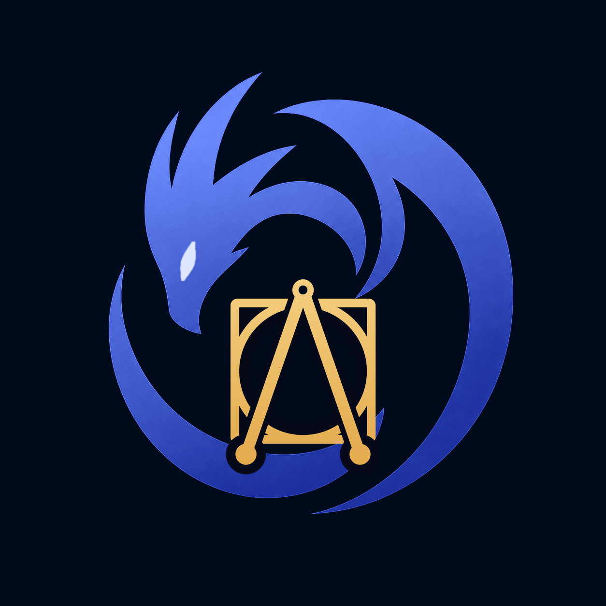
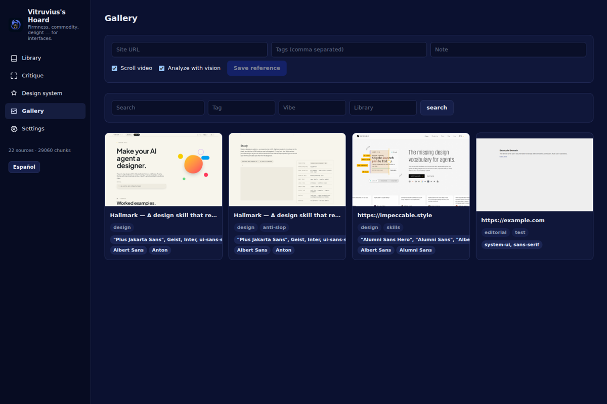
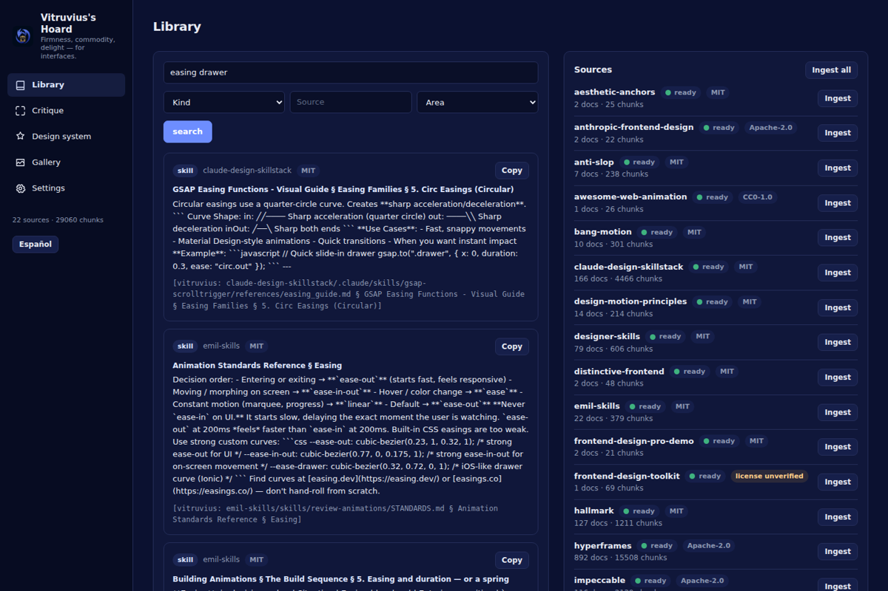
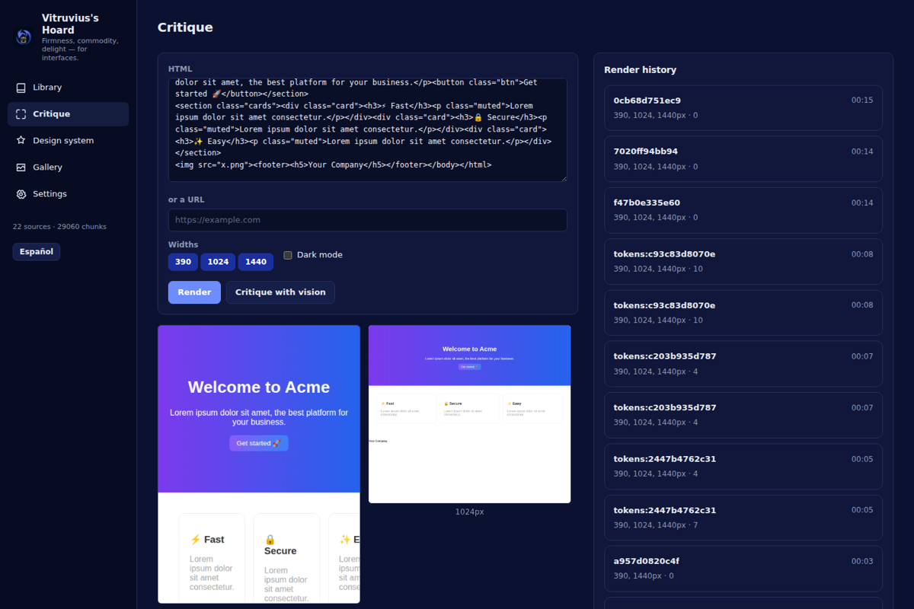
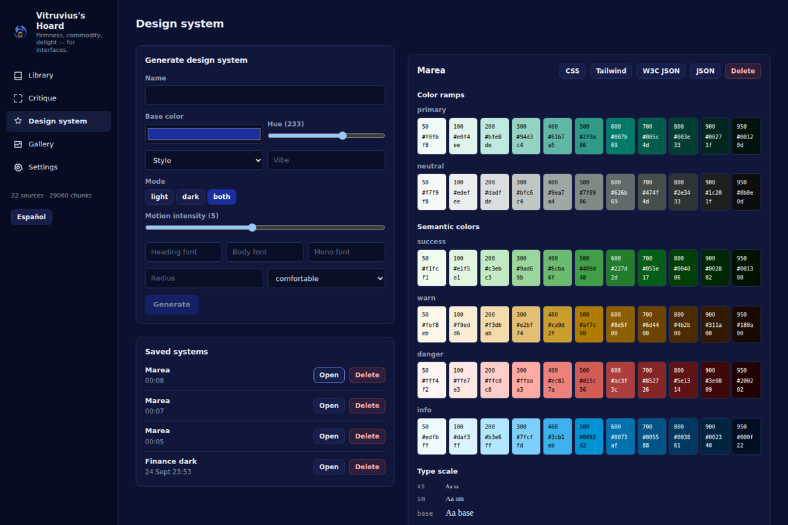

# Vitruvius's Hoard

A local software workbench: interface design, version-exact API documentation and reverse engineering in one app. [Castellano](README.es.md)



## What it is

Vitruvius's Hoard is the design and software-analysis studio of the Hoard family. It has three independent native modules: **Design** (interface design library, rendering, critique, tokens, motion, diagrams and application projects), **APIs** (version-exact documentation and checking of Python libraries) and **Reverse Engineering** (static and dynamic analysis of binaries, packages and web captures). All modules and all automatic work are off when the app starts; enable only what you need.

A root workspace ties them together: a design/source project with an exact source revision can be linked to API environments and to a reverse-engineering project, and results keep identifying the revision they were produced for even after the source is edited.

Language-model work in the app uses only the globally selected model through Faustus. Provider keys stay in Faustus and there is no local fallback model.

## What it does

### Design library and rules
- Searchable library of design criteria, styles, palettes and font pairings, plus a reference gallery with collections, original HTML patterns and curated design galleries that can be captured as references.
- A lint rule registry (static, browser and visual engines) with severities, packs and Spanish text; `design_lint` can run the static engine alone after every edit.
- Critique in three tiers: Floor (never waived), Reflex (waivable with a reasoned justification) and Finish (advice). The gate passes only without Floor findings and open Reflex findings; a clean-context review gives a fresh second look.
- Slop audit: renders a page at eight widths and scores generic-AI-look signs from 0 to 100, with a fix plan and a design direction brief.
- Theme dealing with memory (the same seed gives the same theme, recent themes are blocked), 120 design presets with full light/dark tokens and shadcn registry items, and import of a Figma frame through a personal access token.
- Design tokens with OKLCH palettes, preview and export to CSS and Tailwind.
- Kept-elements check and page assay: save the links, fields and handlers of a page and verify that a redesign keeps them.
- A showcase recipe library at `/showcase/` with working reference pages, reproduction prompts and agent skills.

### Rendering and comparison
- Render HTML or a URL in Chromium to screenshots (several widths) and scroll video; compare two renders.
- Visual parity: frozen-browser comparison of a candidate against a reference, screen by screen, with noise masking.
- Remake: rebuild a public page from its URL or a screenshot until it reaches visual parity, as a copy or a rebuild, with downloadable code and a report.
- A versioned reconstruction benchmark over pinned reference pages with scores by version, runtime and source hash. See [docs/BENCHMARKS.md](docs/BENCHMARKS.md).
- Design by comparable alternatives: frozen criteria, measured alternatives, Pareto frontier, re-weightable ranking and a recorded decision.

### Motion, diagrams and marks
- Motion compositions (timeline, templates) rendered to MP4 or HTML, with sound events mixed to -14 LUFS.
- Diagram editor with templates, connectors, groups, undo/redo and revisions; isometric diagrams, brand profiles, a reusable shape-style library, import of Mermaid, Excalidraw and draw.io subsets, and export to JSON, SVG, PNG, PDF or an interactive HTML reader. See [docs/DIAGRAM_EDITOR.md](docs/DIAGRAM_EDITOR.md).
- Logo audit and test sheet: single-colour behaviour, contrast, small-size legibility and more, scored out of 100.
- SEO and GEO site audit with indexability, security headers, web vitals, AI-crawler access and a phased action plan. See [docs/SITE-AUDIT.md](docs/SITE-AUDIT.md).

### Application projects and instruments
- Application-source projects with templates, typed actions, owned local previews, a functional page checker and standalone export. See [docs/APP_PROJECTS.md](docs/APP_PROJECTS.md).
- Instrument factory: a typed spec of inputs, formulas and outputs becomes an app project with generated tests and a stdlib-only standalone export, plus an explainer. See [docs/INSTRUMENTS.md](docs/INSTRUMENTS.md).
- Protocol checker: explores every interleaving of a small bounded protocol, checks invariants and deadlocks, and returns the shortest counterexample with a reproducing pytest file.

### APIs (Babel)
- Indexes Python packages by exact version, answers lookups and checks source against the selected environment, with docsets, locales and Ask the docs.
- Dependency upgrade rehearsal: indexes the current and target versions in an isolated folder, diffs the API surface and classifies every use in a project as broken, at risk or fine.

### Reverse engineering (Theseus)
- Projects, artifacts, findings, scenarios, comparisons, native sessions, recordings and portable evidence that stays readable after import, without the original files.
- Binary analysis: read-only command queries and explicit command execution, GNU binary inspection, ELF layout, symbols and native context, Android packages and resources, .NET members, Electron sources, firmware, Flutter/Dart snapshots, WebAssembly, packet captures and live editor sessions.
- Web captures: script bytes and source maps, process captures with declared services, and scenario-based reconstruction checks.
- Equivalence workshop: suites of reference/candidate commands compared on identical fresh sandboxes, property tests with shrinking, a rules bank with executable checks, stateful sequences against a real HTTP service, and a causal performance workshop.
- The implemented scope and known gaps are listed in [docs/THESEUS-COVERAGE.json](docs/THESEUS-COVERAGE.json) and [source synchronisation](docs/THESEUS-SYNC.md); the module covers what that inventory declares.

## How to run it

Requires Python and Node 22.19+ (for the analysis core).

```bash
pip install -e .            # optional extras: [render], [vectors], [runtime]
npm ci && npm run build     # also in babel_client/ and in software_native/engine/
python -m vitruvius_hoard   # http://127.0.0.1:5191
```

- `VITRUVIUS_PROFILE_DIR` holds `design/`, `babel/`, `theseus/` and `software-links.db`; the installed default is `%LOCALAPPDATA%/VitruviusHoard/data` (or `~/.local/share/VitruviusHoard/data`).
- `VITRUVIUS_TOKEN_FILE` holds the owner token. `PORT_STRICT=1` pins the port.
- The optional `[render]`, `[vectors]` and `[runtime]` extras provide Chromium rendering, local embeddings and Frida integration. See the [workspace guide](docs/SOFTWARE-WORKSPACE.md).

## Connection with Faustus and Hoard Hub

- `faustus-plugin.json` is the plugin manifest (default URL `http://127.0.0.1:5191`, health at `/api/health`).
- `python -m mcp_server` exposes the cold tool schemas (design, API documentation, reverse engineering and common controls) without starting the app or opening any store. `VITRUVIUS_URL` points to the running app. API, MCP and UI share the same handlers. See [docs/SOFTWARE-API.md](docs/SOFTWARE-API.md) and [docs/NATIVE-CONNECTIONS.md](docs/NATIVE-CONNECTIONS.md).
- The shared Faustus panel is available inside the app.
- The app carries skills from the family's skill library for connected agents (design loop, unslop interface, accessibility, diagram authoring, documentation lookup, code impact analysis, reverse-engineering workflow and others), read with `skills_list` and `skill_read` and chosen on the skills page.

<details>
<summary>Design MCP catalogue</summary>

`design_search`, `design_brief`, `design_rules`, `styles_search`, `palettes_search`, `fonts_search`, `render_preview`, `design_lint`, `design_critique`, `page_assay`, `render_compare`, `tokens_generate`, `tokens_get`, `tokens_list`, `tokens_preview`, `tokens_delete`, `app_templates`, `app_project_create`, `app_project_list`, `app_project_get`, `app_project_update`, `app_project_preview`, `app_project_export`, `app_project_render`, `app_project_call`, `reference_collections`, `reference_import_collection`, `design_patterns`, `design_pattern`, `reference_add`, `reference_search`, `reference_get`, `reference_delete`, `design_galleries`, `design_gallery_ingest`, `sources_list`, `source_add`, `source_ingest`, `source_status`, `vitruvius_status`, `motion_templates`, `motion_save`, `motion_list`, `motion_get`, `motion_render`, `motion_sound_plan`, `motion_sound_render`, `site_audit`, `site_audit_reports`, `mark_audit`, `mark_test_sheet`, `mark_reports`, `diagram_style_list`, `diagram_style_get`, `diagram_style_save`, `diagram_style_remove`, `diagram_style_apply`, `diagram_document_list`, `diagram_document_get`, `diagram_document_save`, `diagram_document_edit`, `diagram_document_undo`, `diagram_document_history`, `diagram_document_compare`, `diagram_document_import`, `diagram_types`, `diagram_render`, `diagram_get`, `diagram_list`, `diagram_delete`, `diagram_brand_onboard`, `diagram_brands`, `diagram_brand_delete`, `page_check`, `design_rules_list`, `theme_list`, `theme_deal`, `theme_check`, `theme_memory`, `page_kept`, `design_slop_audit`, `design_direction_brief`, `design_preset_list`, `design_pick_themes`, `design_preset_apply`, `design_figma_import`, `protocol_check`, `design_alternatives_create`, `design_alternatives_list`, `design_alternatives_get`, `design_alternatives_add`, `design_alternatives_evaluate`, `design_alternatives_criteria`, `design_alternatives_analyze`, `design_alternatives_decide`, `instrument_create`, `instrument_list`, `instrument_get`, `instrument_update`, `instrument_compute`, `instrument_explain`, `instrument_check`, `instrument_export`, `visual_parity`, `visual_parity_get`, `visual_parity_list`, `visual_parity_delete`, `remake_start`, `remake_get`, `remake_list`, `remake_code`, `remake_continue`, `remake_stop`, `remake_delete`, `benchmark_catalog`, `benchmark_start`, `benchmark_get`, `benchmark_list`, `benchmark_compare`, `benchmark_stop`, `benchmark_resume`

</details>

## Screens

<details>
<summary>Screenshots</summary>

 
 

</details>

## Project layout

| Path | Contents |
| --- | --- |
| `vitruvius_hoard/` | Python package: API, design tools, rendering, critique, diagrams, benchmarks |
| `client/` | React/Vite interface |
| `babel_client/`, `babels_hoard/` | API documentation module |
| `theseus/`, `software_native/` | Reverse-engineering module and Node analysis engine |
| `mcp_server.py` | MCP stdio bridge |
| `faustus-plugin.json` | Faustus plugin manifest |
| `docs/` | Reference docs |
| `provenance/` | Source and licence inventory |
| `tests/`, `babel_tests/`, `theseus_tests/` | Test suites |

## Development

```bash
python -m pytest -q
```

Licence: see `LICENSE`, `NOTICE` and `THIRD_PARTY_NOTICES.md`.
